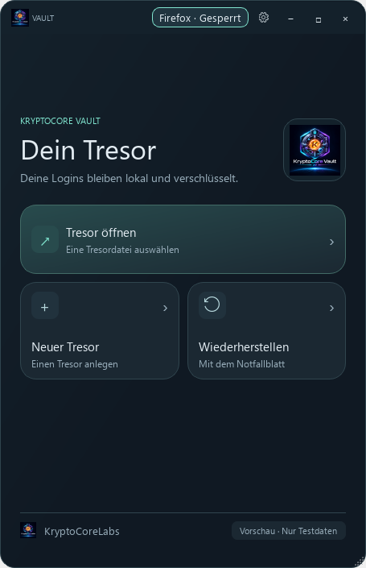
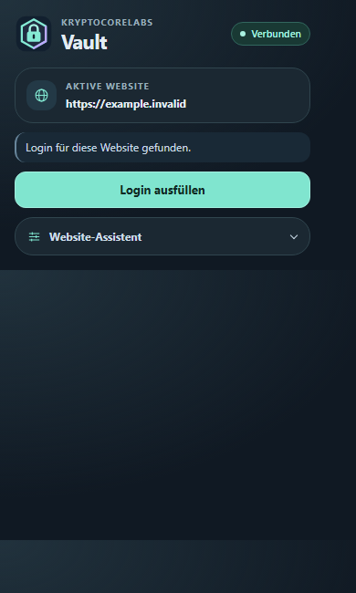

# Shared application design preview

The current development interface follows the Messenger design: dark surfaces,
mint accents, rounded cards and a small product mark. Container, Messenger and
Rescue share their Windows frame and control styles. Vault keeps its compact
layout; the Firefox popup follows the same palette.

This screenshot shows an **unreleased design build**. Existing versioned release
downloads have not been replaced. The update changes presentation and responsive
layout, not encryption formats or existing browser pairings.

Local checks covered every Windows navigation page at normal and minimum sizes,
Container/Rescue recovery and signature workflows, Vault backup and recovery, and
a two-identity Messenger workflow using an offline loopback proxy. They do not
establish accessibility certification or public-Tor delivery for this build.
Windows design executables remain unsigned.

Firefox 0.1.16 is now available as a [Mozilla-signed XPI](FIREFOX.md), with
permanent installation and restart persistence checked in a disposable Firefox
profile. The Windows design executables remain unreleased and unsigned.
Chrome and Edge are planned separately; see [browser support](BROWSERS.md).

The popup image is a static layout fixture, not evidence of a live Firefox connection.
