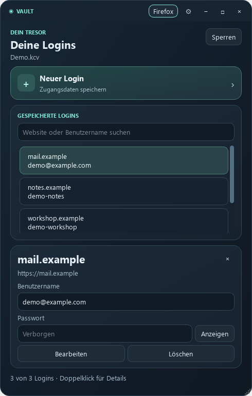

# KryptoCore Vault

[Standalone Windows builds and requirements](PORTABLE.md)

[Unreleased design preview](DESIGN.md)

A local password manager. Vault stores logins in an encrypted
`.kcv` file on your device and uses the open-source
[KryptoCore library](https://github.com/kryptocorelabs/kryptocore).

[Desktop downloads](https://github.com/kryptocorelabs/vault/releases) · [Usage and recovery](USAGE.md) · [Firefox 0.1.16 — signed](FIREFOX.md)

*Development build with synthetic logins. The screenshot shows a newer local
build than the linked download.*

Testing to date has been carried out by the KryptoCoreLabs maintainers, locally
and through automated CI. No independent security audit has been completed.
We welcome community testing, code reviews and scrutiny of our security
assumptions. Please use synthetic data and report suspected vulnerabilities
privately through the project's security-reporting channel.

## Source and community

[Browse the implementation](https://github.com/kryptocorelabs/vault-source) or
read the [project charter](https://github.com/kryptocorelabs/kryptocore/blob/main/PROJECT_CHARTER.md). First-party code is MIT licensed;
dependencies retain their own terms. Contributions and independent review are
welcome. Source visibility does not change the documented preview limits.

The unreleased [recovery hardening](RECOVERY-HARDENING.md) rotates the internal
data key when resetting a password. It does not revoke old vault copies. Existing
download assets have not been replaced; use the documented source/build identity
to establish whether a build includes this fix. See the [threat model](THREAT_MODEL.md).

The development source now includes [native Linux/macOS desktop builds](PLATFORMS.md)
with the same local vault format. Firefox pairing remains Windows-only. Native
CI artifacts are evaluation builds; existing download releases remain unchanged.

## Standalone development build

The current local design build is `KryptoCore-Vault-Portable.exe`, containing
Python, Qt, the Rust backend and the Firefox native host. It starts without
running Setup.cmd. This is an unreleased local build; the older public preview
below still uses its documented Python setup. See [standalone build checks](PORTABLE.md)
and the [design preview](DESIGN.md) for scope and release limits.

## Try the desktop preview

1. Download and extract the Windows x64 desktop ZIP.
2. With Python 3.13 x64 installed, run `Setup.cmd` once.
3. Open `Start-Vault.cmd` and create a test vault.

Use synthetic data for this development preview. See the
[usage notes](USAGE.md) for how to make and test copies of a vault.

## Release status

**Public preview:** 0.1.0-preview.3 for Windows x64.

**Firefox add-on:** [Mozilla-signed 0.1.16](FIREFOX.md) is available for
persistent installation; signature enforcement and restart persistence passed
in Firefox 159.0.1. Windows Authenticode signing is still pending. Full current
desktop/browser workflow testing is a separate release check.

This repository hosts Vault downloads and release notes. The application and Firefox
[source are open under MIT](https://github.com/kryptocorelabs/vault-source).
Use the [security policy](SECURITY.md) to report a suspected vulnerability
privately.

## Offline recovery companion

[Rescue](https://github.com/kryptocorelabs/rescue) is a separate offline preview
for authenticating KCV1/KCV2 files and exporting records to a new plaintext
JSON file. It requires the existing Vault password or a configured KCV2 recovery
key. It does not reset the original password or repair damaged ciphertext.
Use a working copy, retain backups, and protect the unencrypted export.
